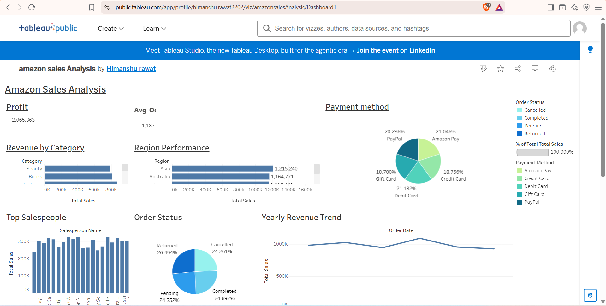

# Amazon Sales Analysis: ETL Pipeline and Tableau Dashboard

An end-to-end data project on 5,000 Amazon e-commerce orders (2019–2024). A Python ETL pipeline cleans the raw CSV, splits it into a relational star schema, and loads it into MySQL. A Tableau Public dashboard then visualizes sales, profit and order performance.

**Live dashboard:** [Amazon Sales Analysis on Tableau Public](https://public.tableau.com/app/profile/himanshu.rawat2202/viz/amazonsalesAnalysis/Dashboard1)



## Tech stack
Python, Pandas, SQLAlchemy, PyMySQL, MySQL, Tableau Public

## Pipeline

```
CSV (data/)  ->  extract.py  ->  transform.py  ->  load.py  ->  MySQL (amazon_sales)  ->  Tableau
```

| Step | File | What it does |
|------|------|--------------|
| Extract | `extract.py` | Reads the raw CSV into a Pandas DataFrame |
| Transform | `transform.py` | Removes duplicate customers/products/salespeople, creates surrogate keys (`product_id`, `salesperson_id`), parses dates (DD-MM-YYYY), renames columns, and splits the flat file into 4 tables |
| Load | `load.py` | Writes the 4 tables into MySQL using SQLAlchemy |
| Orchestrate | `main.py` | Runs extract, transform and load in order |

## Data model

| Table | Rows | Description |
|-------|------|-------------|
| `customers` | 5,000 | `customer_id`, `customer_name` |
| `products` | 3,560 | `product_id`, `product_name`, `category` |
| `salespeople` | 20 | `salesperson_id`, `salesperson_name` |
| `orders` | 5,000 | order details with keys to the other three tables |

`schema.sql` holds the reference table design (primary and foreign keys). Note that `load.py` uses `if_exists="replace"`, so pandas recreates the tables on each run.

## Key numbers (from the dataset)
- Total sales: **5.94M**, total profit: **2.07M**, average order value: **1,187**
- Top region by revenue: **South America** (22% of sales); 2022 was the peak revenue year
- Order status: only **24.6%** of orders were Completed vs **26.5%** Returned (24.5% Pending, 24.3% Cancelled), so the returns process is worth reviewing

## Dashboard views
KPI cards (profit, average order value), revenue by category, region performance, payment method split, order status split, top salespeople, and yearly revenue trend.

## How to run
1. Install MySQL and create the database: `CREATE DATABASE amazon_sales;`
2. Install dependencies: `pip install -r requirements.txt`
3. Set your database credentials as environment variables (see `.env.example`), for example on Windows PowerShell:
   ```
   $env:DB_USER="root"; $env:DB_PASSWORD="your_mysql_password"
   ```
4. Run the pipeline: `python main.py`
5. Connect Tableau (or any SQL client) to the `amazon_sales` database.

## Project structure
```
.
├── data/            # raw CSV
├── docs/            # dashboard screenshot
├── extract.py
├── transform.py
├── load.py
├── main.py
├── schema.sql
├── requirements.txt
└── .env.example
```

## Author
Himanshu Rawat — [GitHub](https://github.com/HIMANSHU592) | [LinkedIn](https://www.linkedin.com/in/himanshu-rawat-hr2)
